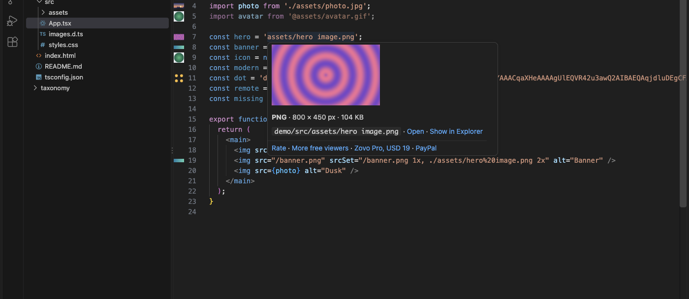

# Image Preview & Image Hover

Image preview by Zovo for VS Code: a thumbnail in the gutter next to every line that names an image, and a hover with the image, its type, its size in pixels and its file size. It works in JavaScript and TypeScript imports, JSX, CSS `url()`, Markdown, HTML `src` and `srcset`, YAML and data URIs. Local files only, no account, works offline.

## Free

- Gutter thumbnails for PNG, JPEG, GIF, WebP, AVIF, SVG, BMP and ICO files, and for `data:image/...` URIs (base64 or plain SVG text).
- Hover: the image (scaled to fit, never enlarged), then type, width × height in pixels, file size and transparency, with links to open the file or show it in the Explorer. TIFF and HEIC files get their size and type from the header.
- Paths that resolve: relative to the file, `/logo.png` from `public/`, `static/` and other web root folders, `@/` for `src/`, `~` for `node_modules` or your home folder, tsconfig.json and jsconfig.json `paths` (with `extends`), and your own prefixes in a setting.
- File names with spaces, `%20`, `?v=2` or `#id` work. A plain name such as `beans.jpg` in JSON is matched to the nearest image with that name.
- Monorepos: each package's own `public/` folder and tsconfig.json are used.
- A missing image says so in the hover, with the paths it looked for. A remote URL shows as a link and is never downloaded.
- No network requests, no telemetry, nothing shows when VS Code starts.

## Zovo Pro

Zovo Pro: USD 19 once. One payment unlocks the Pro tools in every Zovo extension. Each Pro tool has 3 free tries:

- Find unused images: the images in the workspace (or one folder) that no code, style, Markdown, HTML, JSON or YAML file names, largest first. Confirm, and they move to an `_unused-images` folder with their folder structure kept; Edit > Undo moves them back.
- Find broken image references: every image path in the workspace that points to a file that does not exist, with file and line, in a report and in the Problems panel.
- Image weight report: the heaviest images with their pixel size, totals per type, and flags for files over 200 KB, images wider than 2560 px, photos saved as PNG, BMP and TIFF files, and heavy SVGs. The limits are settings.

The Pro tools are in the Command Palette (they end in "(Pro)") and in the Explorer right-click menu of folders ("Zovo Pro: ..."). A try counts only when the tool produced its report; Escape never uses one. `imgPreview.showProTools: false` hides all of it.

Run Zovo Pro: Get Zovo Pro to pay by card, with GitHub Sponsors or PayPal (team of 5: USD 59), or to enter a key.

## How to use it

Open a file that names an image. Thumbnails show in the gutter; hover a path for the details. Commands under Image Preview in the Command Palette:

| Command | What it does |
|---|---|
| Show or Hide Gutter Thumbnails | Turns the gutter icons off or on (setting `imgPreview.gutter`) |
| Open the Sample Files | A small demo project with every kind of path |
| Get Started | The walkthrough |

## Settings

- `imgPreview.aliases`: extra prefixes, for example `{ "@images": "src/assets/images" }`. Values are relative to the workspace folder or absolute.
- `imgPreview.publicFolders`: folders searched for paths that start with `/` (default `public`, `static`, `src`, `assets`, `app`, `www`, `wwwroot`, `docs`).
- `imgPreview.hoverMaxSize`: longest side of the hover image in pixels (default 220).
- `imgPreview.maxFileSizeMB`: larger images are measured but not drawn (default 20).
- `imgPreview.gutter`, `imgPreview.hover`: turn either part off.
- `imgPreview.exclude`, `imgPreview.weightMaxKB`, `imgPreview.weightMaxSide`, `imgPreview.archiveFolder`: options of the Pro tools.

## Privacy

No network requests and no telemetry. Images are read from your disk only. A data URI that is shown in the gutter is written once to the extension's own storage folder, because VS Code draws gutter icons from files.

## Known limits

- Paths built when the code runs (`` `icons/${name}.svg` ``, string concatenation) cannot be previewed, and they can make an image look unused: check the unused list before you move files.
- One thumbnail per line: the first image on that line. The hover works for each path on the line.
- Remote and virtual workspaces (SSH, WSL, Codespaces, vscode.dev) are not supported in this version; the hover image is read from the local disk.
- Webpack, Vite or Next.js aliases that exist only in a JavaScript config file are not read. Add them to `imgPreview.aliases` or tsconfig.json `paths`.
- The weight report measures and flags; it does not compress files.

## Support Zovo

Zovo Pro: USD 19 once, every Zovo viewer. [Get Zovo Pro on GitHub Sponsors](https://github.com/sponsors/theluckystrike/sponsorships?tier_id=679878) to turn on the Pro tools in this extension and in the other Zovo extensions you use. The free features stay free.

Zovo extensions have no ads and no tracking. They are made by [theluckystrike](https://github.com/theluckystrike) on GitHub. You can also support the work with no Pro:

- [Sponsor on GitHub](https://github.com/sponsors/theluckystrike)
- [PayPal](https://www.paypal.com/paypalme/najzzz)
- [Follow theluckystrike on GitHub](https://github.com/theluckystrike)

### Need your format supported?

Open a [format request](https://github.com/theluckystrike/image-preview-vscode/issues/new?template=format-request.yml) with a sample file, and I reply there whether it can be done. For USD 299 once, through [this GitHub Sponsors tier](https://github.com/sponsors/theluckystrike/sponsorships?tier_id=679995), I add your file format or a missing feature to this extension, with tests, within 7 days.

## More tools by Zovo

- [MP4, MOV, MKV & WebM Viewer, Video Player & Preview with Sound](https://marketplace.visualstudio.com/items?itemName=zovo.video-preview-with-sound) plays MP4, MOV, MKV and WebM files with their sound.
- [TIFF Viewer & TIF Viewer (16-bit, GeoTIFF)](https://marketplace.visualstudio.com/items?itemName=zovo.tiff-viewer) opens 16-bit, float, multi-page and GeoTIFF images.
- [Font Viewer, TTF Viewer, OTF & WOFF Viewer, Font Preview](https://marketplace.visualstudio.com/items?itemName=zovo.font-viewer-vscode) opens TTF, OTF and WOFF fonts with a glyph grid and a type tester.
- [SVG Preview & SVG Viewer (PNG Export)](https://marketplace.visualstudio.com/items?itemName=zovo.zovo-svg-viewer) previews SVG beside the editor and exports PNG; scripts never run.

See [all Zovo extensions on the Marketplace](https://marketplace.visualstudio.com/publishers/zovo).

## More from zovo

- [All free zovo VS Code extensions](https://marketplace.visualstudio.com/publishers/zovo) — file viewers, database clients, formatters. Offline, no telemetry, no sign-up.
- [Full MCP server catalogue](https://theluckystrike.github.io/mcp/) — local-first MCP servers for back-office work: invoices, VAT, PDFs, spreadsheets, payroll.
- [Hosted no-install MCP endpoints](https://mcp.zovo.one) — paste a URL in Claude / Cursor, nothing to install.
